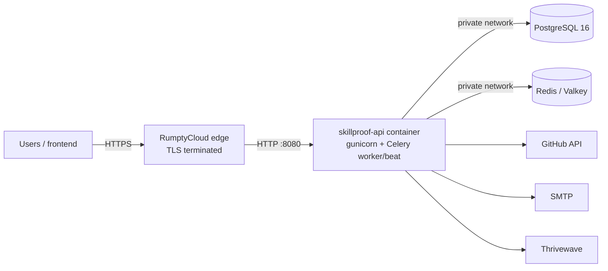

# Deployment (RumptyCloud)

SkillProof's backend deploys to [RumptyCloud](https://rumptycloud.com/) (Lagos). Facts below come
from its docs ([docs.rumptycloud.com](https://docs.rumptycloud.com/)) as of 2026-11-07; points the
docs don't state are marked **unverified**, so check them on the first deploy.

## Shape of the deployment

| RumptyCloud resource | Runs | Notes |
| --- | --- | --- |
| **Deployment** "skillproof-api" (Web Service, Dockerfile, root dir `backend`) | `start.sh` with `ROLE=all`: migrations, gunicorn, Celery worker with embedded beat | One container, because a Deployment is one HTTP service and the docs list no worker type |
| **Managed Database**: PostgreSQL 16 | Application data | Use the **internal** connection string |
| **Managed Database**: Redis (Valkey 8) | Celery broker, rate-limit cache | Use the **internal** connection string |
| (optional) Bucket | Not used yet | Static files are served by WhiteNoise from the image |

Everything stays in one **workspace**, so the app reaches both databases on the private network
(`*.rumpty.internal` hostnames).



### Why one container

`ROLE=all` starts the Celery worker (with `-B`, embedded beat) next to gunicorn and supervises
both: SIGTERM is forwarded to both, and if either dies the container exits with code 1 so the
platform restarts it (tested: `docker stop` exits 0 in ~2 s; killing the worker exits 1). Beat
embedded in the worker is correct only for **one instance**, which is the free tier's maximum.
If you ever scale to several instances, move worker and beat to a VM (below) and set `ROLE=web`.

## Step by step

1. **Workspace and GitHub:** in the console, Settings → GitHub → Connect GitHub App, and give it
   access to this repository.
2. **Databases** (Databases → Create): PostgreSQL 16 (`skillproof-db`) and Redis
   (`skillproof-redis`) in the same workspace. Free *Playground* plans work for the demo (max 2 free
   databases per account). Copy each **internal** connection string.
3. **Deployment** (Deployments → Create):
   - Repository: this repo, branch `main` (or the release branch); **Root directory: `backend`**.
   - Build: **Dockerfile** (the image runs `collectstatic` at build time).
   - Application type: **Web Service/Backend**; **Port: 8080** (the platform injects it as `PORT`;
     don't set `PORT` yourself).
   - **Readiness/health check path: `/api/v1/health`** (no auth; answers before host checks and
     HTTPS redirects, so an internal probe address works).
   - Leave the start command empty (the image's `CMD` is `./start.sh`).
   - Plan: the free tier scales to zero when idle. **For judging, use a paid size that stays awake**
     (e.g. Tiny, up to $2/month): a sleeping container also stops the worker and beat, so analyses
     queue and the Monday digest is missed.
4. **Environment variables** (Env tab, before the first build). See the table below.
5. **Deploy**, then watch **Runs** (build logs) and **Runtime Logs** (JSON lines with
   `request_id`).
6. **Verify** (replace the host):
   ```bash
   API=https://<your-deployment-host>/api/v1
   curl -s $API/health                         # {"status":"ok","checks":{"database":"ok","redis":"ok"},...}
   curl -s -o /dev/null -w '%{http_code}\n' $API/docs/   # 200 (a 301 loop: see "HTTPS" below)
   curl -sI $API/skills | grep -i strict-transport       # HSTS present
   ```
7. **Admin and demo data.** The docs don't describe one-off commands for deployments (`rumpty exec`
   is VM-only), so run them from your machine against the database's **public** endpoint
   (`sslmode=require`):
   ```bash
   cd backend
   export DJANGO_SETTINGS_MODULE=config.settings.prod DJANGO_SECRET_KEY=... FIELD_ENCRYPTION_KEY=... \
          DJANGO_ALLOWED_HOSTS=localhost REDIS_URL=redis://localhost:6379/0 \
          DATABASE_URL='postgresql://<user>:<pass>@<public-host>:5432/<db>?sslmode=require'
   python manage.py createsuperuser
   python manage.py seed_demo                 # idempotent, sends no email/SMS
   python manage.py warm_demo --logins <real-login>,...   # needs GITHUB_TOKEN
   ```
   Migrations run automatically at container start (`ROLE=all` and `ROLE=web`).
8. **Custom domain** (optional, Settings tab): a subdomain such as `api.example.com` (root domains
   aren't supported yet); add the CNAME and TXT records shown and click Verify. Add the domain to
   `DJANGO_ALLOWED_HOSTS`.
9. **GitHub OAuth app for production:** callback
   `https://<frontend>/auth/github/callback`, and set the same URL in `GITHUB_OAUTH_REDIRECT_URI`.

## Environment variables

| Variable | Production value |
| --- | --- |
| `DJANGO_SETTINGS_MODULE` | `config.settings.prod` (the image's default) |
| `DJANGO_SECRET_KEY` | `python -c "import secrets; print(secrets.token_urlsafe(50))"` |
| `DJANGO_ALLOWED_HOSTS` | Your deployment host and custom domain, comma-separated (`.example.app` allows subdomains) |
| `FRONTEND_URL` | `https://<frontend>` (email/SMS links) |
| `CORS_ALLOWED_ORIGINS` | `https://<frontend>` |
| `DJANGO_CSRF_TRUSTED_ORIGINS` | Optional extras; `https://` + each allowed host is trusted automatically |
| `DATABASE_URL` | PostgreSQL **internal** connection string |
| `REDIS_URL` | Redis **internal** connection string (`redis://…`). If you must use the public `rediss://` endpoint, append `?ssl_cert_reqs=none` (Celery requires the parameter) |
| `FIELD_ENCRYPTION_KEY` | `python -c "from cryptography.fernet import Fernet; print(Fernet.generate_key().decode())"`. **Never change it** after users link GitHub, or their stored tokens can't be read |
| `GITHUB_TOKEN` | Fine-grained token, public read access |
| `GITHUB_OAUTH_CLIENT_ID` / `_SECRET` / `GITHUB_OAUTH_REDIRECT_URI` | Production OAuth app |
| `GOOGLE_OAUTH_CLIENT_ID` / `_SECRET` / `GOOGLE_OAUTH_REDIRECT_URI` | Optional. Production Google OAuth client; `https://<frontend>/auth/google/callback` |
| `LLM_API_KEY` (+ optional `LLM_MODEL`) | Anthropic key; empty = template summaries |
| `EMAIL_HOST`, `EMAIL_PORT`, `EMAIL_HOST_USER`, `EMAIL_HOST_PASSWORD`, `EMAIL_USE_TLS`, `DEFAULT_FROM_EMAIL` | Your SMTP provider |
| `SMS_DRY_RUN` | `true` until the Thrivewave format is confirmed |
| `THRIVEWAVE_*` | From the organisers |
| `APP_VERSION`, `GIT_COMMIT_SHA` | Shown by `/health` |
| `SENTRY_DSN` | Optional |
| `ROLE` | `all` (default) |
| `WEB_CONCURRENCY`, `CELERY_CONCURRENCY` | `2` / `2` fit a 512 MB instance |
| `SECURE_SSL_REDIRECT` | `true`; set `false` only if you see a redirect loop (below) |

## HTTPS and the proxy header (unverified)

RumptyCloud terminates HTTPS at its edge and forwards plain HTTP to port 8080. Its docs don't say
whether it sends `X-Forwarded-Proto: https`. Django trusts that header
(`SECURE_PROXY_SSL_HEADER`) to know the original request was HTTPS.

- **If the header is sent** (the norm), everything works: no redirect, secure cookies, HSTS.
- **If it isn't,** `SECURE_SSL_REDIRECT=true` makes every page redirect to itself (step 6 shows
  301s). Set `SECURE_SSL_REDIRECT=false`; the edge already serves HTTPS only. Django admin's login
  keeps working because the API's `https://` origins are in `CSRF_TRUSTED_ORIGINS`.

## Rollback and data

- **Rollback:** every successful build keeps an image (Artifacts tab); "Rollback" redeploys it
  without rebuilding. Migrations are additive in this project; check before rolling back past one.
- **Backups:** managed databases have daily automated backups and on-demand snapshots.
- **Files:** the container filesystem is wiped on each deploy; nothing in SkillProof writes to it
  except the beat schedule file in `/tmp`, which is safe to lose.

## Alternative: a RumptyCloud VM with Docker Compose

If you need several instances, separate processes, or `rumpty exec` for admin commands, run the
same image on a VM (Virtual Machines → Create; Docker installed) with `docker-compose.prod.yml`:

```bash
rumpty ssh <vm-name>
git clone <repo> && cd <repo>/backend
cp .env.example .env    # fill in production values (DATABASE_URL/REDIS_URL internal strings)
docker compose -f docker-compose.prod.yml up -d --build
docker compose -f docker-compose.prod.yml exec web python manage.py seed_demo
```

Then expose port 8080 with `rumpty expose` (see the CLI docs) or put the VM behind the platform's
networking options. On a VM you terminate TLS yourself (e.g. Caddy) or keep the API private behind
a Deployment.

## What CI checks before you deploy

`ruff`, formatting, `makemigrations --check`, `check --deploy` with production settings, the full
test suite on PostgreSQL + Redis, the committed OpenAPI schema, and a production image build.
