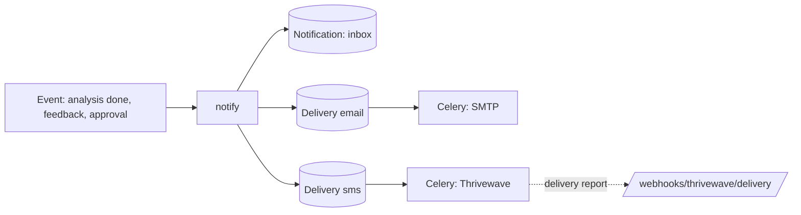

# Notifications

One entry point, `apps.notifications.services.notify(user, kind, context, link_path=...)`:

1. Creates the in-app `Notification` (the inbox).
2. For **email** and **SMS**, checks the preference, the consent and (SMS) a verified phone, then
   creates a `Delivery` row: `queued`, or `skipped` with the reason in `last_error`.
3. Queues one Celery task per queued delivery after the database commit.
4. The task sends; network errors, timeouts and 5xx are retried (3 attempts, 30 s then 60 s);
   4xx-style rejections fail at once. Every attempt is recorded on the Delivery.



## Events and channels

| Kind | Recipient | In-app | Email | SMS | Link |
| --- | --- | --- | --- | --- | --- |
| `analysis_completed` | Job seeker | ✓ | Score, top 3 skills, tips | ✓ | `/u/{login}` |
| `analysis_failed` | Job seeker | ✓ | Reason + what to do (transactional) | – | `/dashboard` |
| `recruiter_feedback` | Job seeker | ✓ | Company, recruiter, status, full message | ✓ | `/inbox` |
| `shortlisted` | Job seeker | ✓ | ✓ | ✓ | `/inbox` |
| `recruiter_approved` / `recruiter_rejected` | Recruiter | ✓ | ✓ (transactional) | if opted in | `/recruiter` |
| `profile_viewed_digest` (Phase 6, Monday 08:00) | Job seeker | ✓ | if any views | – | `/dashboard` |
| Phone verification code | Anyone | – | – | ✓, bypasses preferences, never stored or logged | – |

Feedback and shortlist notifications are triggered from Phase 5; the digest from Phase 6.

## Preferences and consent

- Defaults are created at sign-up from the consent choices: in-app always on; email on for
  transactional kinds, and for the rest only with `email_feedback` consent; SMS only with
  `sms_feedback` consent.
- A message goes out only if the preference **and** the consent allow it (and, for SMS, the phone
  is verified). Changing preferences through the API appends matching consent records, so the
  consent history always tells the truth (Kenya DPA).
- `GET/PUT /api/v1/me/notification-preferences` returns `{matrix: {kind: {channel: bool}}, smsReady}`.

## Templates

`apps/notifications/templates/notifications/<kind>/`: `subject.txt`, `inapp.txt`, `body.txt`,
`body.html` (extends `_base.html`), and `sms.txt` for SMS kinds. Text templates turn autoescaping
off (so "O'Reilly" isn't sent as `O&#x27;Reilly`); HTML templates keep it. Messages are rendered
when the Delivery is created and stored with it, so a retry sends exactly the same text.

## The SMS length rule

SMS must fit **one GSM-7 part: 160 characters**. `sms_text.compose(message, link, footer)`:

1. replaces look-alikes (smart quotes → `'`/`"`, en/em dashes → `-`, `…` → `...`) and drops
   anything else outside GSM-7 (emoji), because one such character would switch the message to
   UCS-2, where a part holds only 70 characters;
2. counts `^{}[]~|\€` as two characters (escape sequence);
3. shortens only the message part, ending it with `...`. The link and "Reply STOP to opt out"
   are never cut.

`tests/notifications/test_sms_text.py` renders every SMS template with absurdly long names and
asserts ≤ 160.

## Thrivewave adapter (SMS)

Thrivewave's API reference is not public. `providers/thrivewave.py` isolates their format in two
methods:

- `build_payload(to_e164, message) -> (headers, json_body)`: placeholder is a
  `Authorization: Bearer <THRIVEWAVE_API_KEY>` header and
  `{"sender_id", "phone": "2547XXXXXXXX", "message"}` (+ `username` if set), POSTed to
  `THRIVEWAVE_BASE_URL + THRIVEWAVE_SMS_PATH`.
- `parse_response(status_code, body) -> SmsResult`: 2xx is success unless the body says
  `success: false` or `status: error/failed`; the message id is read from `message_id`,
  `messageId`, `id` or `request_id`.

**When the real docs arrive:** change those two methods (and `webhooks.parse_delivery_report` /
`parse_inbound` for the callback formats), adjust `test_thrivewave.py`, set the env vars, set
`SMS_DRY_RUN=false`.

**Dry run** (default): when `SMS_DRY_RUN=true` or any of base URL, API key or sender id is missing,
nothing touches the network; the Delivery is stored as `dry_run` and a log line records the masked
number and message length (never the text). The demo can't break because of a missing key.

## Webhooks

| Endpoint | Purpose |
| --- | --- |
| `POST /api/v1/webhooks/thrivewave/delivery` | Delivery report → `Delivery.status` `delivered` / `failed`, matched by `provider_message_id`. Idempotent; a late `failed` never overwrites `delivered`; unknown ids answer 200 |
| `POST /api/v1/webhooks/thrivewave/inbound` | Inbound SMS. STOP / STOPALL / UNSUBSCRIBE / CANCEL / END / QUIT turns off all SMS preferences for that number and records SMS consent as withdrawn |

Both require `X-Thrivewave-Signature: sha256=<hex HMAC-SHA256 of the raw body with
THRIVEWAVE_WEBHOOK_SECRET>` or `X-Thrivewave-Secret: <secret>` (`webhooks.verify_signature`, easy
to swap). Without a configured secret every call is refused. If Thrivewave has no inbound support,
opt-out is manual: an admin turns the user's SMS preferences off (Django admin).

## Testing locally with Mailpit

```bash
make services                     # Mailpit SMTP on :1025, UI on http://localhost:8025
make run
```

Approve a recruiter in `/django-admin/` (or finish an analysis) and the email appears in Mailpit.

To send real mail from a dev machine, point `EMAIL_HOST` at a real server in `.env`, for example
Gmail (needs an app password, not the account password):

```
EMAIL_HOST=smtp.gmail.com
EMAIL_PORT=587
EMAIL_USE_TLS=true
EMAIL_HOST_USER=you@gmail.com
EMAIL_HOST_PASSWORD=<app password>
```

The dev settings only use `EMAIL_HOST_USER`, `EMAIL_HOST_PASSWORD` and `EMAIL_USE_TLS` when the host is
not `localhost`/`127.0.0.1`/`mailpit`, so the Mailpit default keeps working with those values present.
SMS deliveries show `dry_run` in the Delivery admin, which also has a "Retry selected failed
deliveries" action.
