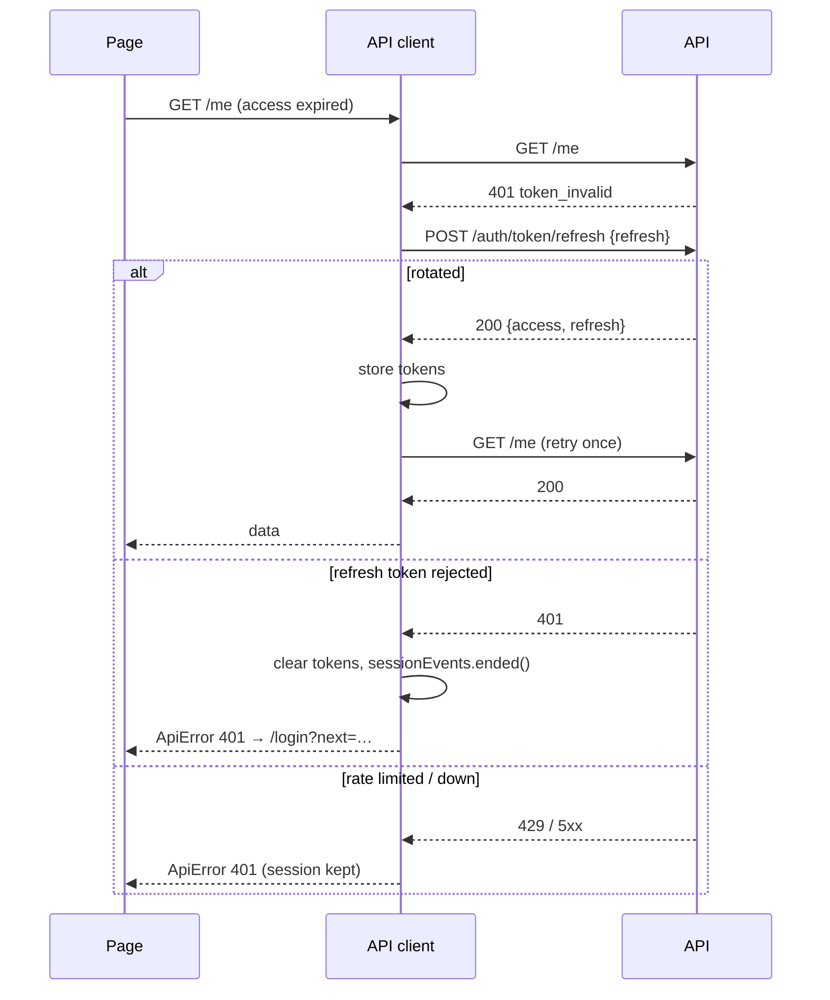
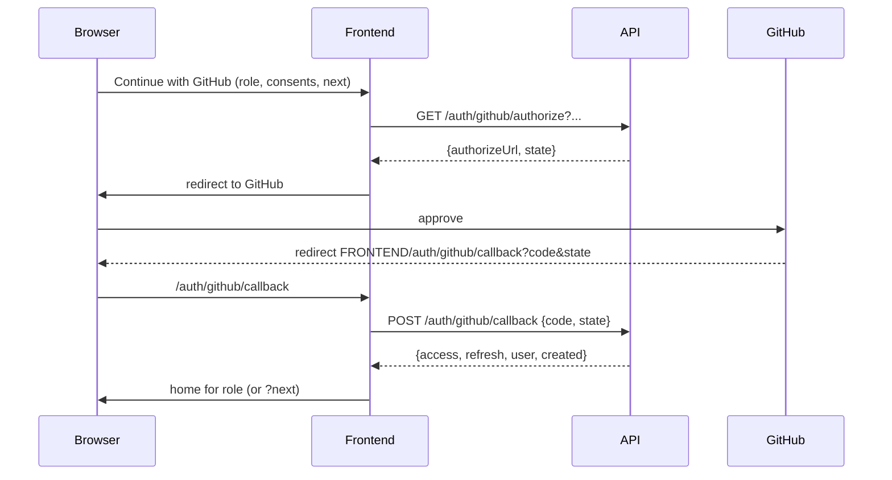

# API integration

## Base URL and CORS

`VITE_API_BASE_URL` (e.g. `http://localhost:8000/api/v1`) is read in `src/lib/env.ts`. Generated
paths include `/api/v1`, so the client's `baseUrl` is the origin. The backend must list the
frontend origin in `CORS_ALLOWED_ORIGINS` and set `FRONTEND_URL` to it (links in emails).

## Generated types

`npm run api:types` runs `openapi-typescript ../backend/openapi.yaml --default-non-nullable false`
into `src/lib/api/schema.d.ts` (also run by `npm run dev`). `npm run api:types:check` fails CI
when the committed file is stale. Friendly aliases live in `src/lib/api/types.ts`; no response
shape is written by hand. When the schema was too loose for a screen (untyped dicts, write-only
fields), the backend serializer was fixed instead (DECISIONS F-018, F-022).

Conventions from the API: JSON keys are camelCase, enum values stay snake_case, path parameters use
snake names (`public_id`, `github_login`), lists are `{count, next, previous, results}`.

## Client middleware (`src/lib/api/client.ts`)

1. Adds `Authorization: Bearer <access>` and an `X-Request-ID` to every request.
2. On a 401 with code `token_invalid`/`not_authenticated`: one shared refresh for all concurrent
   requests, then each request is retried once.
3. Refresh results: `ok` → retry; `invalid` (400/401) → clear tokens, `sessionEvents.ended()`,
   redirect to `/login?next=…`; `unavailable` (429, 5xx, offline) → keep the session, return the
   original error (F-020).

## Tokens and refresh

- Access token: memory only. Refresh token: `localStorage["skillproof.refresh"]` (rotated on every
  refresh; the old one is blacklisted by the backend).
- On load, `AuthProvider` refreshes (retrying up to 3 times on `unavailable`, honouring
  `Retry-After`) and loads `/me` before guarded routes render.

## GitHub OAuth

Linking from Settings uses the same flow with `link: true` while signed in.

## Polling

- Analysis: `GET /analyses/{id}` every 1.5 s until `completed`/`failed` (paused in background tabs);
  the backdrop glow follows `progressStep`.
- Notification bell: unread list every 60 s. Admin stats: every 60 s. Admin analyses: every 15 s.

## Error codes → UI

`src/lib/api/errors.ts` maps codes to plain copy: `validation_error` → "Check the highlighted
fields." plus per-field messages from `fields`; `rate_limited` → the backend's "Try again in N
seconds"; `invalid_credentials`, `email_not_verified`, `github_not_linked`, `no_public_repos`,
`analysis_in_progress`, `recruiter_not_approved` (and a redirect to the pending screen),
`network_error` → "We couldn't reach SkillProof…". Unknown codes get a generic message;
`ErrorState` shows the request id for support.

## Adding an endpoint

1. Add it to the backend with `@extend_schema` (typed request/response serializers), run
   `make schema` in `backend/`, commit `openapi.yaml`.
2. `npm run api:types`.
3. Add a type alias in `types.ts` if it's used in several places, a key in `query-keys.ts`, and a
   hook next to the feature (`features/<area>/api.ts`).
4. Call it with `unwrap(api.GET("/api/v1/...", { params }))`; the compiler checks paths, params and
   bodies.
5. Add an MSW handler in the component test, using fixtures typed from the schema.
