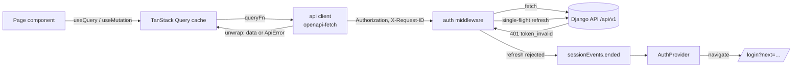

# Architecture

A Vite + React 18 + TypeScript single-page app. The Django API (`../backend`) is the contract:
every call is typed from `backend/openapi.yaml`.

## Folders

```text
src/
  main.tsx, App.tsx      entry: providers → AuthProvider → RouterProvider
  app/
    router.tsx           every route, guards, lazy chunks
    lazy-page.tsx        React.lazy pages for guarded routes (guard runs before page code loads)
    providers.tsx        TanStack Query, Radix tooltip, progress glow, sonner toasts
    layouts/             PublicLayout (pill nav), AuthLayout (planet), AppShell (sidebar, bell, menu)
    pages/               404, route error, placeholders
  components/
    glass/               GlassPanel / GlassCard / GlassPill / LitEdge (the three glass tiers)
    space/               SpaceBackdrop, SignalPlanet (3D, lazy) + static fallback, capability checks
    ui/                  Button, Field/Input/Select/Textarea, Dialog, DataTable, Segmented, Toggle,
                         Pagination, ChipInput, OtpInput, Badge, States (empty/error/skeleton/stat)
  features/              one folder per area; each owns its pages, hooks (api.ts) and parts
    landing/ legal/ auth/ card/ analysis/ seeker/ notifications/ settings/ recruiter/ admin/
  lib/
    api/                 client (openapi-fetch + middleware), errors, query keys, generated schema
    auth/                tokens, AuthProvider, guards, redirects
    env.ts labels.ts format.ts phone.ts password.ts utils.ts
  styles/                tokens.css (design tokens), globals.css (glass tiers, base)
  test/                  MSW server, fixtures typed from the schema, render helper
e2e/                     Playwright: flows, a11y, responsive, screenshots
```

## Providers

`Providers` (Query client, tooltips, progress glow, toasts) wraps `AuthProvider`, which wraps the
router. `AuthProvider` bootstraps the session before any protected route renders (refresh → `/me`)
and listens for `sessionEvents.ended` from the API client.

## Routing and guards

- Public routes (`/`, `/u/:login`, `/terms`, `/privacy`) use React Router `lazy`.
- Auth routes sit under `GuestOnly` (signed-in users go to their home).
- `/app`, `/recruiter`, `/admin` are wrapped in `RequireAuth roles=[…]`; pages load with
  `lazyPage`, so a signed-out visit redirects before downloading the page. The app shell and auth
  layout are lazy too, so the landing page and public card never download them.
- Recruiters who aren't approved are sent to `/recruiter/pending`.
- `/inbox` and `/dashboard` (links in emails, SMS and notifications) resolve to the user's area.
- Page titles come from each route's `handle.title`.

## Data flow



- Server state lives only in TanStack Query; keys are in `lib/api/query-keys.ts`.
- Mutations invalidate by key prefix; list edits (shortlist moves, read receipts, preferences)
  are optimistic with rollback.
- Filters and pagination live in the URL (`useSearchParams`), so views are shareable.
- `unwrap()` turns every failure into an `ApiError {status, code, message, fields, requestId}`;
  forms map `fields` onto inputs, everything else becomes a toast or an `ErrorState`.

## Performance budget

- First load for a visitor: React vendor chunk + entry (~125 KB gzipped together), the page chunk,
  CSS and fonts. three.js (~290 KB) loads only on the landing/auth pages, only on a real GPU, and
  only when the browser is idle; the public card draws its radar as plain SVG (no chart library).
- `index.html` paints a static shell before JavaScript runs.
